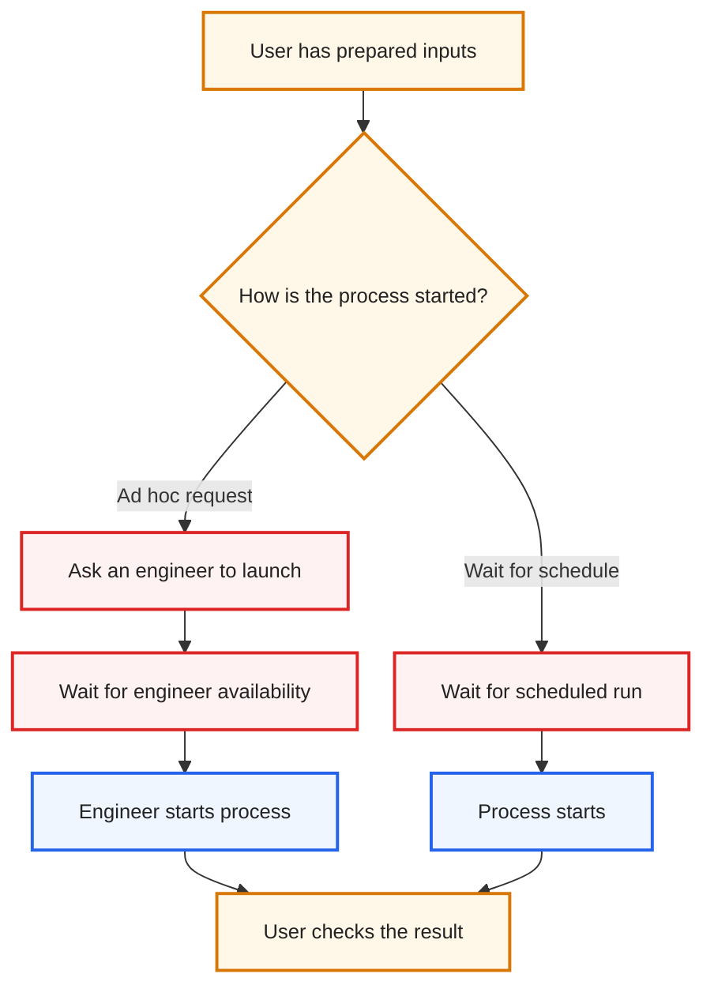
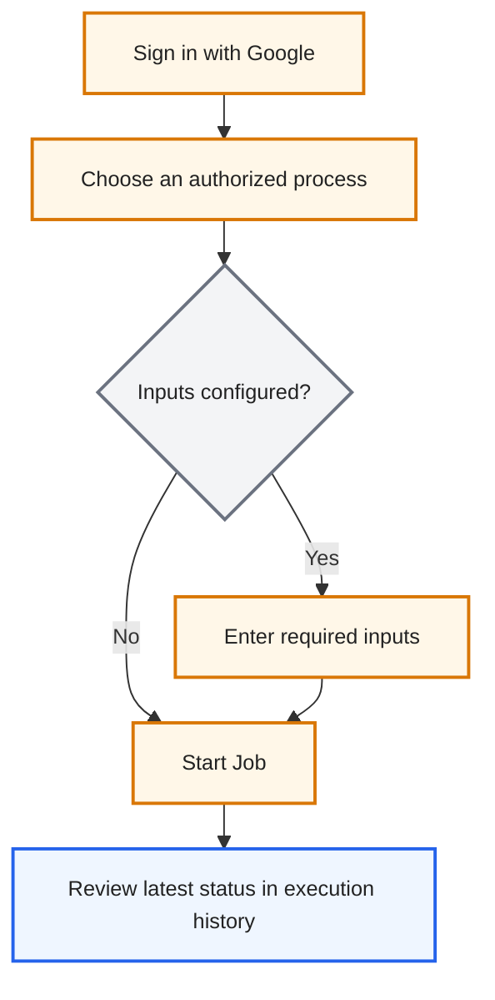
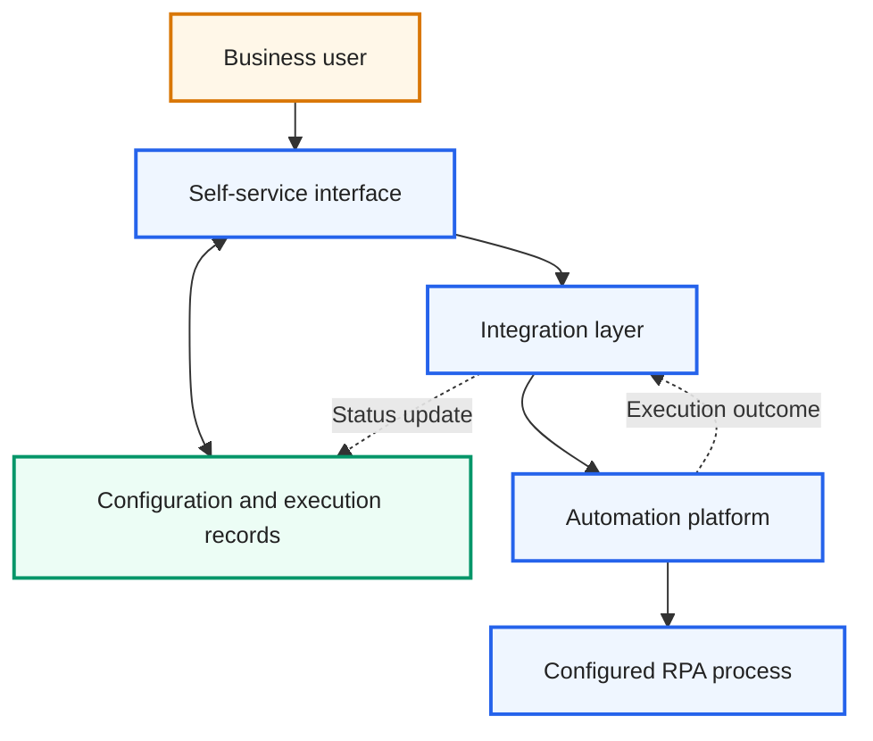
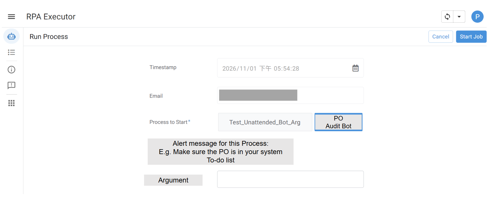
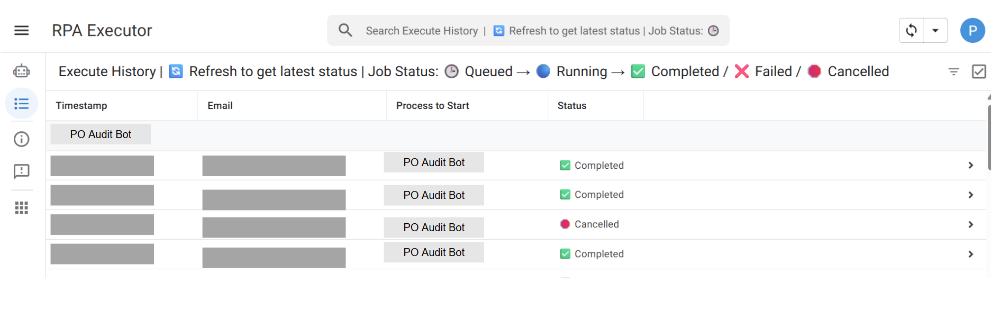

# Self-Service RPA Job Launcher

> **A permission-aware, no-code launcher that lets business users start approved RPA jobs from a familiar Google Workspace experience, provide required inputs, and follow execution status.**

An anonymized case study of a production tool built with AppSheet, Google Apps Script, Google Sheets, and UiPath Orchestrator for user-triggered automation.

## Contents

- [The business problem](#the-business-problem)
- [Business value and evidence](#business-value-and-evidence)
    - [Initial rollout](#initial-rollout)
    - [Why this approach](#why-this-approach)
    - [Configuration-led and decoupled by design](#configuration-led-and-decoupled-by-design)
- [User journey](#user-journey)
    - [As-Is — engineer-mediated launch](#as-is--engineer-mediated-launch)
    - [To-Be — user self-service](#to-be--user-self-service)
- [High-level solution components](#high-level-solution-components)
- [What the user sees](#what-the-user-sees)
- [How the spreadsheet-backed setup works](#how-the-spreadsheet-backed-setup-works)
- [My contribution and technology](#my-contribution-and-technology)
- [Scope and privacy](#scope-and-privacy)

## The business problem

- Some jobs are ready when users finish preparing data—not at a scheduled time or system event.
- Previously, users had to ask an engineer to launch them. The tool enables authorized users to start approved processes directly from Google Workspace.

## Business value and evidence

### Less waiting, less handoff

- Start an approved process as soon as its inputs are ready instead of waiting for a future trigger or engineer. This can shorten cycle time, though no reduction has been measured.
- Familiar Google Workspace access, configurable process/argument permissions, and visible execution status support simple, controlled self-service.

### Initial rollout

In production for an initial set of high-demand processes. Broader rollout can follow operational-fit and governance review.

### Why this approach

A platform-native launcher was less suitable for this occasional-use case because of its separate user experience and commercial model. The choice prioritized user fit; no specific license-cost saving is claimed.

### Configuration-led and decoupled by design

Process-specific settings are separated from launch logic and maintained in a workbook. Supported changes can often be made without code edits; each process still requires platform setup, testing, and governance. The conceptual diagram below shows the main components without implementation details.

## User journey

The contrast is simple: the user still decides when the work is ready, but no longer needs an engineer to perform the launch.

### As-Is — engineer-mediated launch

*Color key: user actions = amber · waiting or handoff = red · process execution = blue.*

### To-Be — user self-service

Google sign-in pre-fills the user's email and timestamp. Users select an authorized process, enter any displayed arguments, then start the job and review the newest entry in execution history. Status uses both visual indicators and text: **Queued**, **Running**, **Completed**, **Failed**, or **Cancelled**.

*Color key: user actions = amber · decision = gray · execution tracking = blue.*

### High-level solution components

This high-level view names the main solution blocks only. It intentionally omits implementation-level data paths, payloads, event mechanisms, identifiers, and security configuration.

*Color key: user = amber · service components = blue · configuration and records = green.*

## What the user sees

Actual interface screenshots, reviewed and redacted for this portfolio:

### Select a process and provide inputs

### Follow execution status

## How the spreadsheet-backed setup works

Google Sheets stores launcher settings and run history. The tables below use **conceptual labels, not the workbook's actual column names or schema**; all sample values are fictional.

### Process catalog

| Process group | Process shown to user | Launch setup | User guidance |
|---|---|---|---|
| Demo Group A | Demo Process A | Configured destination | Enter a reference number before starting. |
| Demo Group B | Demo Process B | Configured destination | Select a run date if needed. |

The catalog controls which processes appear and what guidance users see.

### User-to-process permissions

| Process group | Process | Authorized user *(fictional)* |
|---|---|---|
| Demo Group A | Demo Process A | Alex Example |
| Demo Group B | Demo Process B | Jordan Example |

Only listed user/process pairs can launch; this configuration complements platform-side permissions.

### Process-specific argument definitions

| Process | Input shown to user | Corresponding process input | Required? |
|---|---|---|---|
| Demo Process A | Reference number | Reference number input | Yes |
| Demo Process B | Run date | Process date input | No |

User-facing labels map to the parameter names expected by each process.

### Execution history

| Submitted at | Process *(fictional)* | Current status | Example input |
|---|---|---|---|
| 2026-10-30 09:15 | Demo Process A | ✅ Completed | Reference number: 2048 |
| 2026-10-30 09:42 | Demo Process B | 🔵 Running | Run date: 2026-10-30 |

The history links each launch to its outcome; it is an operational record, not a replacement for an enterprise database or audit platform.

## My contribution and technology

I designed and implemented the integration, configuration model, job launch, and status tracking.

**Technology:** AppSheet · Google Apps Script · Google Sheets · UiPath Orchestrator API and webhooks · Google Workspace sign-in

## Scope and privacy

- This launcher does not replace automation governance; process access settings must be maintained alongside platform permissions.
- Examples are fictional. Do not publish internal spreadsheets, identities, URLs, job identifiers, credentials, or source code.
- Recheck screenshots for identifying details before publishing updates.
