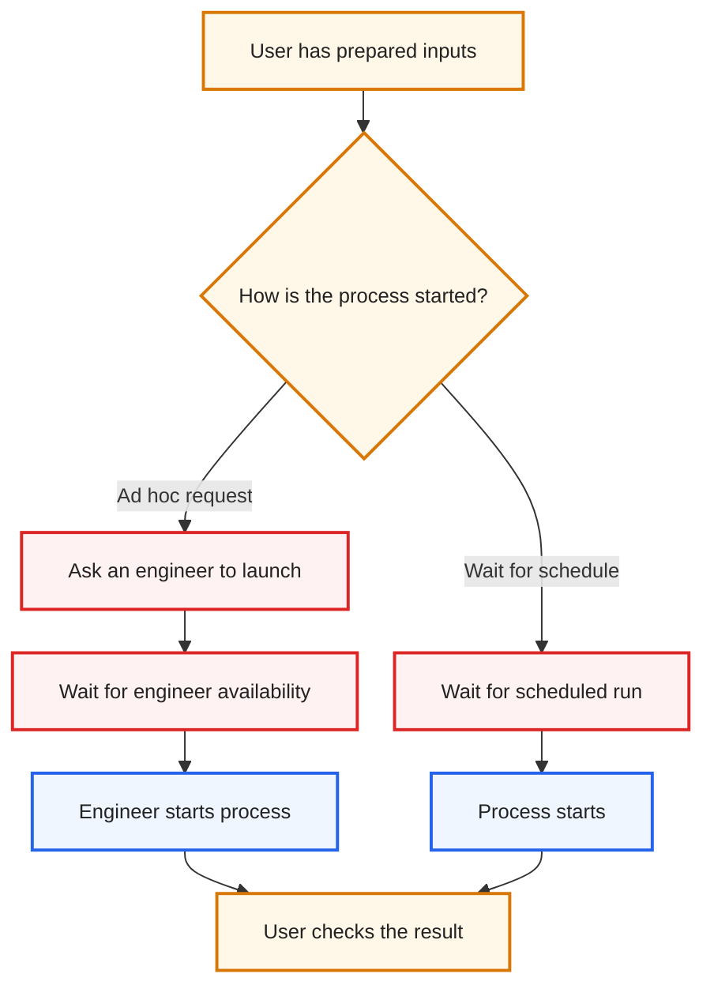
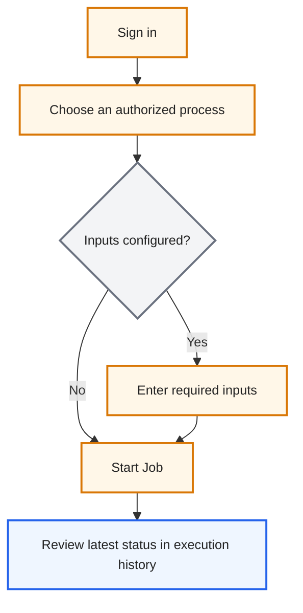
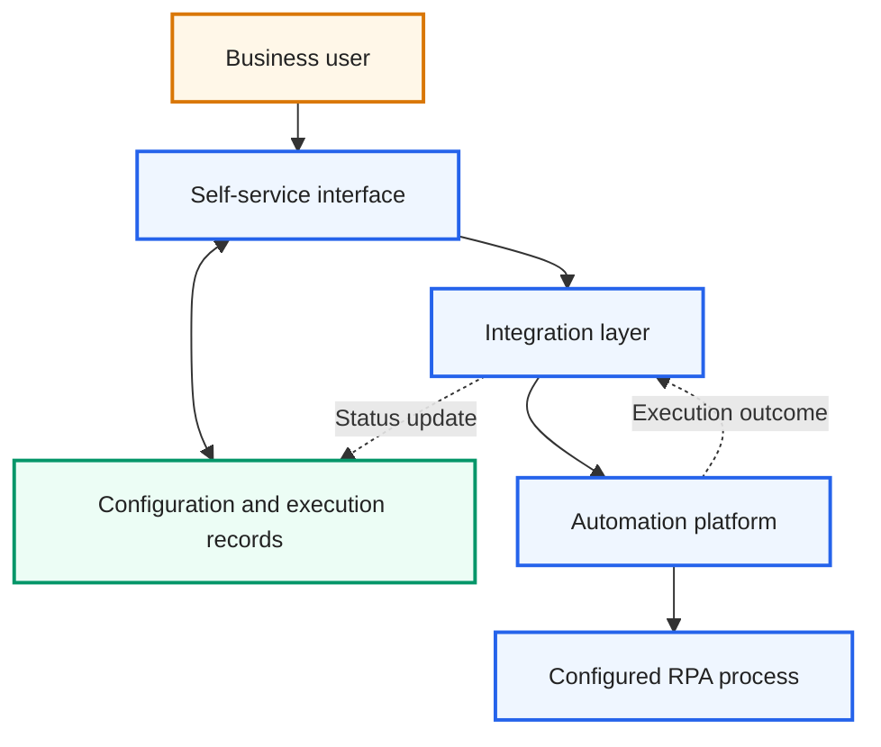
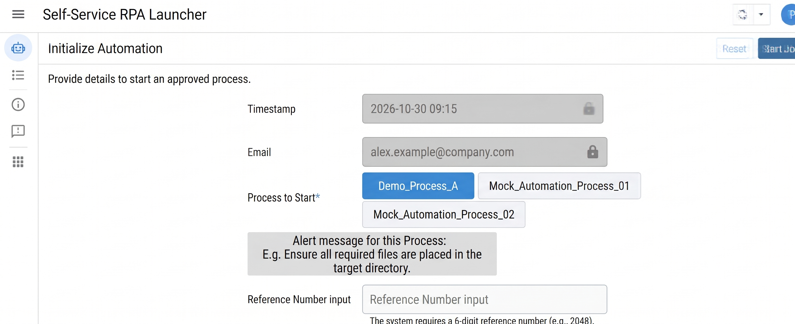
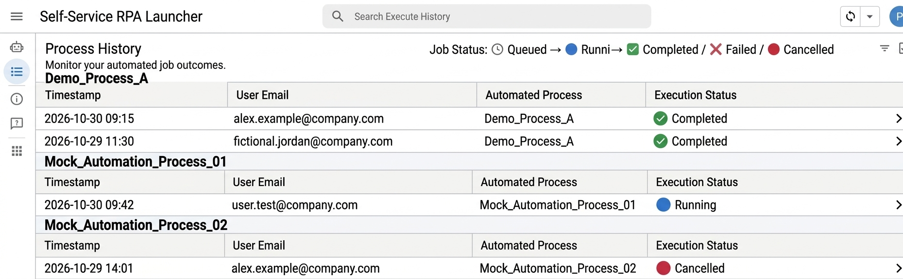

# Self-Service RPA Job Launcher

> **A portfolio concept for making approved automations easier to request, start, and track—with clear user inputs, access boundaries, and execution visibility.**

A from-scratch conceptual design exercise showing how a self-service RPA launcher could address the handoff between business users and automation teams. This repository is documentation and architecture reference only: it contains no functional scripts, application source code, employer data, or production configuration.

## Contents

- [Self-Service RPA Job Launcher](#self-service-rpa-job-launcher)
  - [Contents](#contents)
  - [The business problem](#the-business-problem)
  - [Business value](#business-value)
    - [Less waiting, less handoff](#less-waiting-less-handoff)
    - [Why this approach](#why-this-approach)
    - [Configuration-led architecture](#configuration-led-architecture)
  - [User journey](#user-journey)
    - [As-Is — engineer-mediated launch](#as-is--engineer-mediated-launch)
    - [To-Be — user self-service](#to-be--user-self-service)
    - [High-level solution components](#high-level-solution-components)
  - [What the user sees](#what-the-user-sees)
    - [Select a process and provide inputs](#select-a-process-and-provide-inputs)
    - [Follow execution status](#follow-execution-status)
  - [Conceptual data model](#conceptual-data-model)
    - [Process options](#process-options)
    - [Access boundaries](#access-boundaries)
    - [Example input definition](#example-input-definition)
    - [Example execution history](#example-execution-history)
  - [Design contribution and architecture](#design-contribution-and-architecture)
  - [Scope and privacy](#scope-and-privacy)

## The business problem

- Some automation requests are ready only after a user has prepared the required inputs—not at a fixed schedule or system event.
- A self-service launch experience can reduce the need for users to coordinate each ad hoc run through an automation engineer.

## Business value

### Less waiting, less handoff

- Let users request a run when their inputs are ready, potentially reducing avoidable waiting and manual handoffs.
- Make the intended self-service experience easier to understand through clear process choices, input guidance, access boundaries, and visible status.
- These are design goals, not measured outcomes or claims about a deployed system.

### Why this approach

A dedicated launch experience can be useful when occasional users need a clear, guided entry point without navigating an automation platform directly. The concept prioritizes user fit and operational clarity; it makes no cost-savings or deployment claims.

### Configuration-led architecture

The conceptual model separates process definitions, user-facing input guidance, access decisions, and execution history from the user interface. This illustrates how configuration-led design can support change and governance; it does not describe an implemented workbook, platform setup, or live integration. The diagram below intentionally stays at an architectural level.

## User journey

The design illustrates how a user could decide when the work is ready and submit an authorized launch request without a manual engineer handoff.

### As-Is — engineer-mediated launch

*Color key: user actions = amber · waiting or handoff = red · process execution = blue.*

### To-Be — user self-service

In the conceptual flow, identity and submission time provide context for a request. Users select an authorized process, enter any displayed arguments, then submit and review the status in execution history. Status uses both visual indicators and text: **Queued**, **Running**, **Completed**, **Failed**, or **Cancelled**.

*Color key: user actions = amber · decision = gray · execution tracking = blue.*

### High-level solution components

This high-level view names generic solution blocks only. It intentionally omits implementation-level data paths, payloads, event mechanisms, identifiers, and security configuration.

*Color key: user = amber · service components = blue · configuration and records = green.*

## What the user sees

AI-generated conceptual UI mockups for this portfolio. They are illustrative examples, not screenshots of a company or production system:

### Select a process and provide inputs

### Follow execution status

## Conceptual data model

The tables below illustrate a possible information model using **fictional example values and generic concepts only**. They do not reproduce an existing workbook, database, or internal schema.

### Process options

| Example process name | Example user guidance |
|---|---|
| Demo_Process_A | Enter a reference number before starting. |
| Mock_Automation_Process_01 | Check the process details before submitting. |
| Mock_Automation_Process_02 | Check the process details before submitting. |

The conceptual catalog represents the kinds of choices and guidance a self-service launcher might present.

### Access boundaries

| Example process name | Example authorized user *(fictional)* |
|---|---|
| Demo_Process_A | Alex Example |
| Mock_Automation_Process_01 | Jordan Example |
| Mock_Automation_Process_02 | Alex Example |

The example illustrates that a design can consider user-to-process authorization alongside platform-level governance; it is not an operational access-control configuration.

### Example input definition

| Example process name | Input label shown in mockup | Required? |
|---|---|---|
| Demo_Process_A | Reference Number input | Yes |

This corresponds to the reference-number field shown in the launcher mockup; no underlying process parameter or implementation is included.

### Example execution history

| Timestamp | Example user email *(fictional)* | Example process name | Example status |
|---|---|---|---|
| 2026-10-30 09:15 | alex.example@company.com | Demo_Process_A | ✅ Completed |
| 2026-10-29 11:30 | fictional.jordan@company.com | Demo_Process_A | ✅ Completed |
| 2026-10-30 09:42 | user.test@company.com | Mock_Automation_Process_01 | 🔵 Running |
| 2026-10-29 14:01 | alex.example@company.com | Mock_Automation_Process_02 | 🔴 Cancelled |

These fictional examples mirror the process names and statuses in the AI-generated history mockup. A real implementation would need appropriate data retention, privacy, and audit controls.

## Design contribution and architecture

This portfolio piece presents a conceptual integration model, a high-level data model, and a workflow-tracking design for a self-service RPA launch experience. It focuses on architectural decisions—guided inputs, permission-aware process selection, decoupled configuration concepts, and status visibility—not on production implementation.

**Conceptual architecture:** self-service interface · configuration and execution records · integration layer · automation orchestration platform. These are generic architecture roles, not a claim that this repository contains or connects to specific platforms.

## Scope and privacy

- This is a personal portfolio concept designed from scratch for illustrative purposes; it contains no former or current employer proprietary code, internal data, credentials, or production configuration.
- This repository is documentation and architecture reference only. No functional scripts or application source code are hosted here.
- Process names, identities, timestamps, inputs, and statuses are fictional examples created to match the AI-generated mockups.
- The diagrams describe generic architectural concepts and omit organization-specific implementation details.
